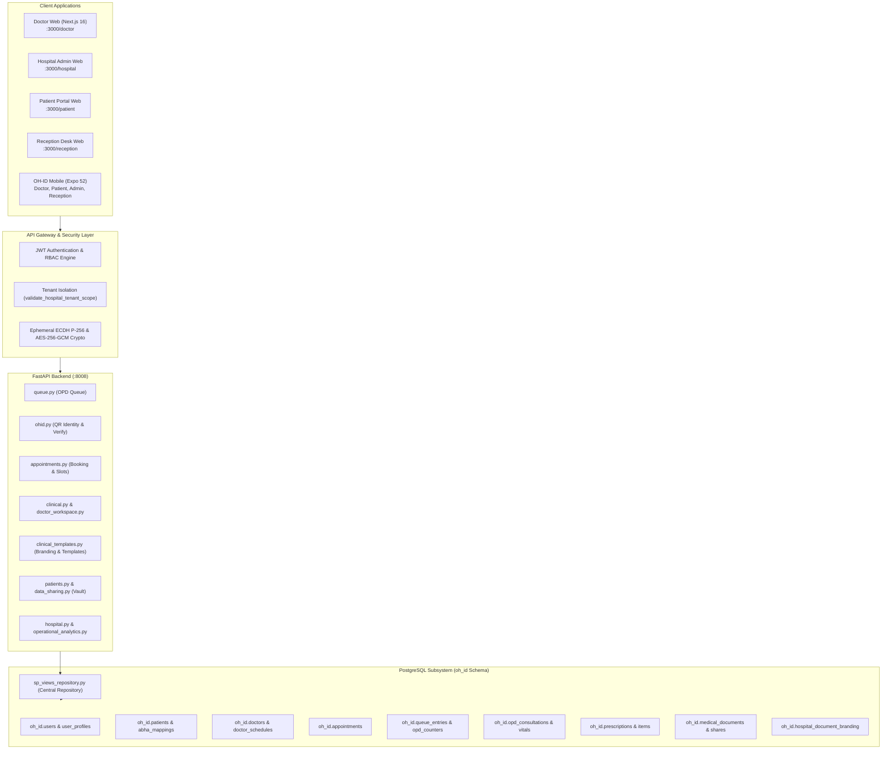

# OH-ID — COMPLETE ARCHITECTURE AUDIT REPORT
**Platform:** OneHealth ID (OH-ID) Enterprise Healthcare Ecosystem  
**Author:** Principal Healthcare Software Architect, Product Reverse Engineering Specialist & Senior Full-Stack Engineer  
**Organisation:** Sathus Technology Private Limited  
**Audit Date:** November 2026  
**Status:** COMPLETE & GROUNDED IN CODEBASE  

---

## 1. Executive Summary

This architecture audit provides an exhaustive inspection of the existing **OneHealth ID (OH-ID)** repository across all five architectural layers:
1. **Frontend Web Application** (Next.js 16 App Router, TypeScript, Tailwind CSS, Lucide Icons)
2. **Mobile Application** (Expo SDK 52, React Native, TypeScript, File-based routing)
3. **Backend Application** (FastAPI, Python 3.12, Pydantic v2, JWT RBAC/ABAC)
4. **Database & Storage Subsystem** (PostgreSQL on Supabase, `oh_id` schema with 235 tables, SQL Views & Stored Procedures Repository)
5. **Security, Cryptography & Compliance Subsystem** (Ephemeral ECDH P-256 key exchange, AES-256-GCM payload encryption, digital signatures, ABHA/ABDM National Health Stack integration)

All findings in this report are based strictly on direct inspection of the repository files, live running services, and database schemas.

---

## 2. System Architecture Inventory

---

## 3. Detailed Component Audit by Module

### 3.1 Module 1: QR Check-in & OPD Queue Management
* **Web Routes:**
  - `frontend/app/scan/page.tsx` & `frontend/app/scan/[token]/page.tsx`: QR scanner interface for kiosk and patient verification.
  - `frontend/app/reception/page.tsx`: Reception desk check-in, patient intake, and queue assignment.
  - `frontend/app/queue/page.tsx`: Public / waiting hall live queue display.
  - `frontend/app/doctor/queue/page.tsx`: Doctor's active OPD queue with call/start/skip/hold controls.
* **Mobile Screens:**
  - `mobile/app/(doctor)/scan.tsx`: Doctor camera QR scanner.
  - `mobile/app/(reception)/index.tsx`: Receptionist mobile token desk.
  - `mobile/app/(patient)/index.tsx`: Dynamic zero-knowledge patient OneHealth ID QR card.
* **Backend Services:**
  - `backend/app/routers/ohid.py`: `/api/v1/oh-id/qr/generate`, `/api/v1/oh-id/qr/verify`, and `/api/v1/oh-id/search`.
  - `backend/app/routers/queue.py`: `/api/v1/queue`, `/api/v1/queue/{id}/action`, `/call`, `/recall`, `/skip`, `/hold`, `/complete`.
  - `backend/app/repositories/sp_views_repository.py`: `check_in_patient_visit`, `list_queue_entries`, `execute_queue_transition`.
* **Database State:**
  - `oh_id.appointments` (contains `checkin_token`, `checked_in_at`, `token_number`, `token_prefix`).
  - `oh_id.queue_entries` (tracks live OPD status: `WAITING`, `CALLED`, `IN_CONSULTATION`, `COMPLETED`, `HOLD`, `SKIPPED`).
  - `oh_id.opd_counters` (department-specific counter configs and token prefixes).

### 3.2 Module 2: Doctor Clinical Workspace
* **Web Routes:**
  - `frontend/app/doctor/consultation/[id]/page.tsx`: 10-section Unified Clinical Encounter screen.
  - `frontend/components/clinical/ConsultationSummaryPrintView.tsx`: Branded printable clinical report.
  - `frontend/components/clinical/TemplateSamplePreview.tsx`: Dynamic layout renderer supporting 20 clinical report & prescription templates.
* **Mobile Screens:**
  - `mobile/app/(doctor)/consultation.tsx`: Full mobile parity 10-section clinical encounter.
  - `mobile/app/(doctor)/rxpad.tsx`: Standalone Digital RxPad with 4-digit PIN cryptographic signing.
  - `mobile/src/components/clinical_documents/ClinicalReportTemplateRenderer.tsx`: Mobile clinical report renderer.
  - `mobile/src/components/clinical_documents/PrescriptionTemplateRenderer.tsx`: Mobile prescription renderer.
* **Backend Services:**
  - `backend/app/routers/clinical.py` & `doctor_workspace.py`: Consultation recording, vitals recording, ICD-10 search.
  - `backend/app/routers/prescriptions.py`: Multi-medication digital prescription creation, PIN verification, signing, and verification.
  - `backend/app/routers/clinical_templates.py`: Institutional templates and 11-color branding palette.
* **Database State:**
  - `oh_id.opd_consultations` (snapshots `vitals`, `examination`, `diagnoses`, `branding_version`, `branding_snapshot`, `digital_signature_hash`).
  - `oh_id.prescriptions` and `oh_id.prescription_items` (dosage form, strength, frequency, route, duration, food relation).
  - `oh_id.clinical_document_templates` and `oh_id.hospital_document_branding`.

### 3.3 Module 3: Patient Appointment Booking
* **Web Routes:**
  - `frontend/app/patient/appointments/page.tsx`: Patient appointment center with filter by hospital, doctor, family member, and status.
  - `frontend/components/appointments/AppointmentBookingModal.tsx`: Multi-step booking flow (Hospital -> Doctor -> Date & Time Slot -> Reason -> Confirmation).
  - `frontend/components/appointments/RescheduleAppointmentModal.tsx` & `CancelAppointmentModal.tsx`.
* **Mobile Screens:**
  - `mobile/app/(patient)/appointments.tsx`: Mobile appointment list, detail view, cancellation, and booking modal.
* **Backend Services:**
  - `backend/app/routers/appointments.py`: `/api/v1/appointments` (list, create, reschedule, cancel, check-in).
  - Slot duration and advance booking rules loaded from `oh_id.hospitals` configuration.
* **Database State:**
  - `oh_id.appointments` (tracks `slot`, `appointment_date`, `appointment_time`, `status`, `reschedule_history`, `cancellation_reason`).
  - `oh_id.doctor_schedules` (doctor working days and shifts).

### 3.4 Module 4: Patient Health Vault
* **Web Routes:**
  - `frontend/app/patient/records/page.tsx`: Unified health records gallery.
  - `frontend/app/patient/documents/page.tsx`: Document upload, categorization, preview, and sharing.
  - `frontend/app/patient/prescriptions/page.tsx` & `frontend/app/patient/labs/page.tsx`.
* **Mobile Screens:**
  - `mobile/app/(patient)/timeline.tsx`: Longitudinal health timeline.
  - `mobile/app/(patient)/upload.tsx`: Camera and gallery document upload with MIME validation.
  - `mobile/app/(patient)/prescriptions.tsx`: Patient digital prescription cards with QR verification.
* **Backend Services:**
  - `backend/app/routers/patients.py`: Medical document fetch, upload, and metadata indexing.
  - `backend/app/routers/data_sharing.py`: Time-bound consent sharing links with zero-knowledge share tokens.
  - `backend/app/routers/document_ocr.py`: OCR text extraction from uploaded medical records.
* **Database State:**
  - `oh_id.medical_documents` (stores file metadata, type, size, hash, tags, and review status).
  - `oh_id.medical_document_shares` and `oh_id.medical_document_audit_logs`.

### 3.5 Module 5: Hospital Administration Dashboard
* **Web Routes:**
  - `frontend/app/hospital/page.tsx`: Real-time operational overview command center.
  - `frontend/app/hospital/settings/page.tsx`: Facility settings, token rules, appointment rules, document templates, and 11-color branding palette.
  - `frontend/app/hospital/doctors/page.tsx` & `frontend/app/hospital/staff/page.tsx`: Clinical roster and RBAC.
  - `frontend/app/hospital/counters/page.tsx` & `frontend/app/hospital/departments/page.tsx`.
* **Mobile Screens:**
  - `mobile/app/(admin)/index.tsx`: Mobile admin command center with bed census, staff roster, and document template preferences.
* **Backend Services:**
  - `backend/app/routers/hospital.py` & `operational_analytics.py`: Operational overview metrics, alerts, departmental breakdowns.
  - `backend/app/routers/clinical_templates.py`: Hospital branding and document template APIs.
* **Database State:**
  - `oh_id.hospitals`, `oh_id.departments`, `oh_id.opd_counters`, `oh_id.hospital_document_branding`.
  - Multi-tenant boundary enforced by `validate_hospital_tenant_scope`.

---

## 4. Key Strengths Identified

1. **High Code Quality & Consistency:** Clean separation of concerns with strong TypeScript typing in Web and Mobile.
2. **Centralized Data Access:** `sp_views_repository.py` provides clean abstraction over raw SQL and views, preventing SQL injection and standardizing business logic.
3. **Rigorous Multi-Tenant Isolation:** Server-side validation via `validate_hospital_tenant_scope` ensures Hospital A can never access or modify Hospital B data.
4. **Legal & Document Immutability:** Finalized consultations and prescriptions preserve `branding_version` and `branding_snapshot`, ensuring historical medical records are immutable.
5. **ABDM / ABHA Standards Alignment:** Built-in ABDM milestones (M1/M2/M3), HFR, HPR, and patient ABHA linking models.

---

## 5. Architectural Integrity Constraints

* **No Architecture Regeneration:** Enhance existing routes, components, and stored procedures in-place.
* **Preserve Auth & Session Handshakes:** Retain existing JWT RBAC and ephemeral ECDH P-256 payload crypto.
* **Single Logical Encounter:** Maintain unified clinical encounter workflow across Web and Mobile.
* **Strict Tenant Boundary:** Every database query must remain scoped by `hospital_id` or `patient_id`.

