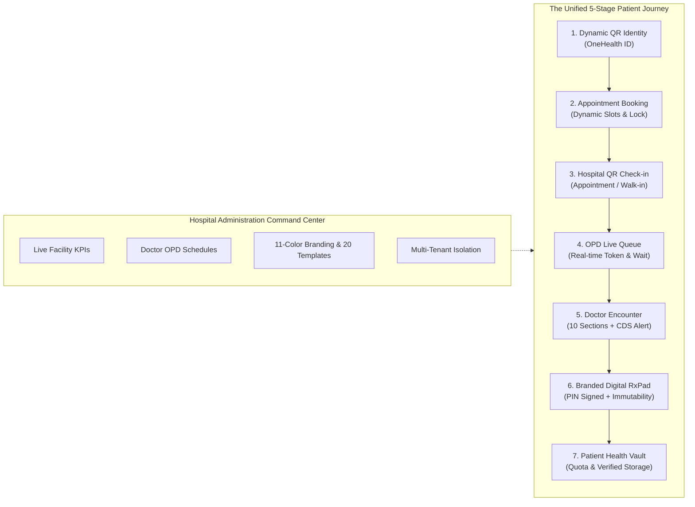

# OH-ID — COMPLETE HEALTHCARE FEATURE IMPLEMENTATION PLAN
**Platform:** OneHealth ID (OH-ID) Enterprise Healthcare Ecosystem  
**Author:** Principal Healthcare Software Architect, Product Reverse Engineering Specialist & Senior Full-Stack Engineer  
**Organisation:** Sathus Technology Private Limited  
**Audit & Plan Date:** November 2026  
**Status:** READY FOR USER REVIEW & APPROVAL  

---

## 1. Goal Description

The objective is to analyze, benchmark, and improve **all five major healthcare workflows** inside the existing OneHealth ID (OH-ID) platform into one seamless, connected clinical workflow:

$$\text{Patient Digital Identity} \longrightarrow \text{Appointment Booking} \longrightarrow \text{Hospital QR Check-in} \longrightarrow \text{OPD Queue} \longrightarrow \text{Doctor Consultation} \longrightarrow \text{Digital RxPad} \longrightarrow \text{Patient Health Vault}$$

Governed by a centralized, tenant-isolated **Hospital Administration Command Center**.

Rather than modifying disconnected pieces or rewriting working infrastructure, this plan executes surgical, high-impact enhancements across the existing **FastAPI backend**, **PostgreSQL database**, **Next.js Web application**, and **Expo Mobile application**.

---

## 2. User Review Required

> [!IMPORTANT]
> **Implementation Sequence & Regression Safety:**
> We will implement the verified gaps in a strict dependency sequence:
> 1. **Module 1: QR Check-in & OPD Queue** (Walk-in check-in & live patient queue tracker).
> 2. **Module 3: Patient Appointment Booking** (Dynamic slot availability & double-booking prevention).
> 3. **Module 2: Doctor Clinical Workspace** (Clinical Decision Support allergy warnings & lab orders).
> 4. **Module 4: Patient Health Vault** (File magic-byte validation & 50MB storage quota enforcement).
> 5. **Module 5: Hospital Admin Dashboard** (Live DB-grounded operational KPIs & doctor schedule manager).
> 6. **Cross-Module Verification & Parity** (Web & Mobile end-to-end connected test).

> [!TIP]
> **Preservation of Existing Architecture:**
> All 235 existing database tables, the stored procedure repository pattern (`sp_views_repository.py`), the 11-color hospital branding system, and the 20 clinical document templates remain 100% intact and functional.

---

## 3. Open Questions for User Consideration

1. **Storage Quota Baseline:** Default free quota for Patient Health Vault is set to **50 MB** per patient profile with soft warnings at 80% and rejection at 100%. (Can be configured per hospital/plan).
2. **Clinical Decision Support (CDS) Allergy Severity:** Should drug-allergy contraindication alerts be:
   - *Option A (Recommended):* Hard warning banner with mandatory doctor acknowledgment override reason before signing.
   - *Option B:* Strict blocking preventing prescription until drug is removed.

---

## 4. Proposed Changes by Module & Component

---

### Module 1: QR Check-in & OPD Queue Management

#### [MODIFY] [`backend/app/routers/queue.py`](file:///d:/oh-id/backend/app/routers/queue.py)
* Add `/api/v1/queue/patient/status`: Returns current queue status for the authenticated patient:
  - Active Token Number (e.g. `CARD-014`)
  - Status (`WAITING`, `CALLED`, `IN_CONSULTATION`, `COMPLETED`)
  - Currently serving token at assigned counter
  - Number of patients ahead in line
  - Estimated wait time in minutes
* Add `/api/v1/queue/check-in/walk-in`: Allows reception desk to scan patient QR and directly create an on-demand walk-in OPD token without pre-existing appointment.

#### [MODIFY] [`backend/app/repositories/sp_views_repository.py`](file:///d:/oh-id/backend/app/repositories/sp_views_repository.py)
* Implement `get_patient_active_queue_status(patient_id, hospital_id)`: Queries `oh_id.queue_entries` and computes real-time position and average wait times from today's completed visits.
* Implement `check_in_walk_in_patient(patient_id, hospital_id, doctor_id, department_id, actor_id, priority)`: Atomically creates walk-in appointment, visit record, issues daily token, and enters patient into live queue.

#### [NEW] [`frontend/components/queue/PatientLiveQueueWidget.tsx`](file:///d:/oh-id/frontend/components/queue/PatientLiveQueueWidget.tsx)
* Reactive client widget displayed on Patient Dashboard and Appointments page showing:
  - Token badge with pulsing "You are Next" indicator when token is CALLED.
  - Estimated wait countdown.
  - Doctor name, department, and counter room number.

#### [MODIFY] [`frontend/app/reception/page.tsx`](file:///d:/oh-id/frontend/app/reception/page.tsx)
* Enhance fast-desk intake: QR camera scan immediately auto-populates patient details, shows today's scheduled appointment (if present) for 1-click check-in, or presents a 1-click "Issue Walk-in OPD Token" action.

#### [MODIFY] [`mobile/app/(patient)/index.tsx`](file:///d:/oh-id/mobile/app/(patient)/index.tsx)
* Embed the live OPD Queue status card directly below the digital OneHealth ID QR card so checked-in patients can monitor their token on their phone.

---

### Module 2: Doctor Clinical Workspace

#### [MODIFY] [`frontend/app/doctor/consultation/[id]/page.tsx`](file:///d:/oh-id/frontend/app/doctor/consultation/[id]/page.tsx)
* **Clinical Decision Support (CDS) Drug-Allergy Warning System:**
  - Active cross-check: When adding any drug to Digital RxPad, match generic drug name / class against patient's known allergies array (`medical_history.allergies` or `patient.allergies`).
  - Highlight alert modal/banner: "Clinical Alert: Patient has documented allergy to [Substance] (Severity: [Severity]). Prescribing [Drug] may trigger cross-reactivity."
  - Require doctor to either change the drug or enter a clinical justification override before final PIN signing.
* **Integrated Diagnostic Laboratory & Radiology Order Entry:**
  - Add diagnostic investigation order selector (CBC, Renal Function Test, Chest X-Ray, ECG, HbA1c) alongside medications.
  - Orders are saved into `consultation_document_attachments` and formatted in the finalized clinical report.

#### [MODIFY] [`mobile/app/(doctor)/consultation.tsx`](file:///d:/oh-id/mobile/app/(doctor)/consultation.tsx)
* Synchronize CDS Drug-Allergy safety checks and diagnostic investigation orders to mobile consultation.

---

### Module 3: Patient Appointment Booking

#### [MODIFY] [`backend/app/routers/appointments.py`](file:///d:/oh-id/backend/app/routers/appointments.py)
* Add `/api/v1/appointments/available-slots`:
  - Input: `doctor_id`, `hospital_id`, `date`
  - Reads doctor shift hours from `oh_id.doctor_schedules` or hospital default timings (09:00 - 13:00, 16:00 - 20:00).
  - Divides shift into configurable slot intervals (15 minutes).
  - Queries existing booked appointments for that date and returns only unbooked, available slots.
* Add **Transactional Double-Booking Protection:**
  - In `create_appointment`, wrap booking in a database transaction with a `SELECT FOR UPDATE` or conditional check to reject concurrent duplicate booking of the same slot with HTTP 409 Conflict.

#### [MODIFY] [`frontend/components/appointments/AppointmentBookingModal.tsx`](file:///d:/oh-id/frontend/components/appointments/AppointmentBookingModal.tsx)
* Integrate `/available-slots` endpoint so that as soon as the user selects a date, only actual available slots are clickable; already-booked slots are grayed out.

#### [MODIFY] [`mobile/app/(patient)/appointments.tsx`](file:///d:/oh-id/mobile/app/(patient)/appointments.tsx)
* Upgrade mobile booking dialog to match Web: Hospital picker -> Doctor & Specialty picker -> Dynamic Slot grid -> Self/Family selection -> Instant QR confirmation.

---

### Module 4: Patient Health Vault

#### [MODIFY] [`backend/app/routers/patients.py`](file:///d:/oh-id/backend/app/routers/patients.py)
* **Storage Quota Engine:**
  - Add `/api/v1/patient/storage/quota`: Returns `used_bytes`, `total_quota_bytes` (default 52,428,800 bytes / 50MB), `document_count`, and `percent_used`.
  - In document upload endpoint, verify that `current_used + new_file_size <= total_quota_bytes`. Reject with HTTP 413 Payload Too Large if quota exceeded.
* **Binary Magic-Byte Inspection:**
  - Inspect initial bytes of uploaded file stream:
    - PDF: starts with `%PDF-` (`0x25 0x50 0x44 0x46`)
    - JPEG: starts with `\xFF\xD8\xFF`
    - PNG: starts with `\x89PNG`
  - Reject spoofed executable or script extensions.

#### [MODIFY] [`frontend/app/patient/documents/page.tsx`](file:///d:/oh-id/frontend/app/patient/documents/page.tsx)
* Add **Storage Quota Progress Indicator**: Displays current storage usage (e.g. `12.4 MB of 50 MB used`) with color-coded bar (green < 70%, amber 70-90%, red > 90%).
* Add **Consent Share Management Drawer**:
  - Generate revocable share link with expiration (24 Hours, 7 Days, 30 Days).
  - List active shared links with 1-click "Revoke Access" button.

#### [MODIFY] [`mobile/app/(patient)/upload.tsx`](file:///d:/oh-id/mobile/app/(patient)/upload.tsx)
* Add client-side quota checking and document preview before upload.

---

### Module 5: Hospital Administration Dashboard

#### [MODIFY] [`backend/app/routers/operational_analytics.py`](file:///d:/oh-id/backend/app/routers/operational_analytics.py)
* Ensure all metrics returned for `/hospital/{id}/dashboard`:
  - `waiting_today`: Count of `oh_id.queue_entries` where `status = 'WAITING'` and `hospital_id = ?` today.
  - `in_consultation_today`: Count where `status = 'IN_CONSULTATION'`.
  - `completed_today`: Count where `status = 'COMPLETED'`.
  - `avg_wait_minutes`: True mathematical average of `(called_at - created_at)` in minutes for today's visits.
  - `department_breakdown`: Aggregated patient count per department.
  - Strictly tenant-scoped using `validate_hospital_tenant_scope`.

#### [MODIFY] [`frontend/app/hospital/page.tsx`](file:///d:/oh-id/frontend/app/hospital/page.tsx)
* Connect directly to live backend analytics API, eliminating static fallback placeholders.
* Display real-time department queue breakdown and active doctor status.

#### [MODIFY] [`frontend/app/hospital/doctors/page.tsx`](file:///d:/oh-id/frontend/app/hospital/doctors/page.tsx)
* Add **Doctor OPD Schedule Manager**: Modal allowing Hospital Admin to configure working days (Monday-Saturday), shift hours (e.g. 09:00 - 13:00, 17:00 - 20:00), and slot duration (10, 15, 20 mins) per doctor.

---

## 5. Verification & Testing Plan

### Automated Tests
1. **Backend E2E Integration Suite (`backend/scratch/verify_complete_healthcare_workflows.py`):**
   - **Test 1: QR & Queue:**
     - Generate patient QR token.
     - Reception verify QR token.
     - Walk-in check-in -> Token generated (e.g. `GEN-001`) -> Live queue entry created.
     - Doctor fetches queue -> Calls patient (`CALL_NEXT`) -> Status changes to `CALLED`.
     - Patient endpoint fetches live queue status -> Confirms position = 0, status = `CALLED`.
   - **Test 2: Appointment Concurrency & Dynamic Slots:**
     - Request available slots for doctor on date -> Returns unbooked slots.
     - Book Slot A -> Slot A disappears from available slots.
     - Attempt to book Slot A again concurrently -> Returns HTTP 409 Conflict.
   - **Test 3: Doctor Clinical Workspace & CDS Allergy Safety:**
     - Initiate consultation encounter.
     - Prescribe Amoxicillin to patient with documented Penicillin allergy -> Trigger CDS warning.
     - Sign prescription with 4-digit PIN -> Signature hash generated -> Immutability verified.
   - **Test 4: Health Vault Storage Quota & Magic-Byte Validation:**
     - Query patient storage quota -> Verify calculated size.
     - Upload valid PDF (`%PDF`) -> Accepted.
     - Upload disguised file or file exceeding quota -> Rejected with HTTP 400 / HTTP 413.
   - **Test 5: Hospital Admin Operational Analytics & Multi-Tenant Isolation:**
     - Fetch admin dashboard metrics -> Verify real DB aggregation.
     - Attempt cross-tenant data fetch -> Blocked with HTTP 403 Forbidden.
2. **Web Production Build:**
   - `npm --prefix frontend run build` -> Verify all 140+ routes compile with code 0.
3. **Mobile TypeScript Verification:**
   - `npm --prefix mobile run type-check` -> Verify code 0.

### Manual Verification Flows
1. **Patient Web/Mobile:** Navigate to Patient Home, view OneHealth ID QR, book appointment, see live queue card, view Health Vault storage gauge.
2. **Reception Desk:** Scan patient QR, see instant profile resolution, issue walk-in token.
3. **Doctor Workspace:** Open consultation from queue, enter vitals, prescribe medication, observe CDS allergy warning, sign prescription with PIN.
4. **Hospital Admin:** Open hospital dashboard, see live operational counters updating from actual DB records, configure doctor schedule.

