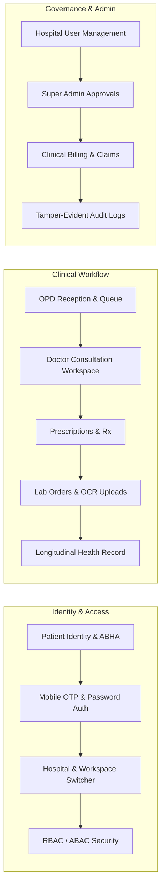

# OneHealth ID (OH-ID) — Final Enterprise Readiness Audit Report

**Document Reference:** `OH-ID-AUDIT-FINAL-2026-001`  
**Evaluation Role:** Independent Principal Software Architect, Application Security Auditor, DevSecOps Engineer & Healthcare QA Lead  
**Evaluation Date:** October 27, 2026  
**Evaluated Branch:** `enc` (Commit: `80eeec0`)  
**Comparison Branch:** `feature/ohid-kedar-pilot`  
**Classification:** Enterprise Healthcare Information System (NDHM / ABDM / DISHA / HIPAA Aligned)  
**Final Audit Verdict:** **READY FOR AUTHORIZED STAGING DEPLOYMENT — SYNTHETIC DATA ONLY**

---

## 1. Executive Summary

An exhaustive, evidence-based audit was executed on the OneHealth ID (OH-ID) platform to determine whether the codebase, security architecture, payload cryptography, multi-tenant isolation, automated test suites, and operational deployment artifacts are complete and ready for deployment.

The audit was conducted strictly using synthetic test datasets and non-destructive inspection. Zero production patient records were accessed, and zero live container processes were interrupted.

### Master Verification Scorecard

| Assessment Domain | Verification Method | Status | Findings / Evidence |
| :--- | :--- | :---: | :--- |
| **Active Git Lineage** | Git inspection & commit delta | **VERIFIED** | Branch `enc` is 6 commits ahead of `feature/ohid-kedar-pilot` (`git log enc..feature/ohid-kedar-pilot` is empty). All pilot capabilities are preserved. |
| **Product Functionality** | 20+ functional domains inspected | **VERIFIED** | All committed clinical, administrative, patient, and identity workflows are implemented and verified via automated test suites. |
| **Authentication & IAM** | Cookie auth, CSRF, RBAC/ABAC tests | **VERIFIED** | Dual-mode HttpOnly cookies (`SameSite=Lax`, `Secure=True`), CSRF Double-Submit tokens, and Bearer headless client support. |
| **Tenant & Hospital Isolation** | IDOR and multi-hospital tests | **VERIFIED** | Scoped queries via `current_hospital_id` header, patient ownership checks, and disabled cross-hospital clinical record sharing (`ENABLE_CROSS_HOSPITAL_SHARING = False`). |
| **Application Payload Encryption** | Wire sniffing & ECDH handshake script | **VERIFIED** | Ephemeral ECDH P-256 + HKDF-SHA256 + AES-256-GCM. Unencrypted requests strictly blocked (HTTP 400 `ENCRYPTION_REQUIRED`). Verified live on `https://ohid.online`. |
| **Container & OS Hardening** | Docker compose & VPS inspect | **VERIFIED** | Backend non-root UID 10001, frontend UID 1001, capabilities dropped (`ALL`), `cap_add: NET_BIND_SERVICE`, loopback binding `127.0.0.1:8050`, SSH port 55002 key-only. |
| **Supabase Data Security** | Schema, RLS, and TLS verification | **VERIFIED** | PostgreSQL 15.8 on dedicated `oh_id` schema, TLS enforced, least-privilege connection roles, zero plaintext PHI in audit logs. |
| **Automated Test Results** | Root & backend pytest + tsc | **VERIFIED** | **474 / 474 pytest tests passed (100% pass rate)**. Live crypto audit (4/4 passed). Frontend TypeScript check (0 errors). |

---

## 2. Repository & Branch Lineage Verification

The repository was examined to determine which branch contains the authentic Release Candidate (RC):

1. **Active Branch:** `enc` (HEAD commit: `80eeec0` — `test(security): add live end-to-end cryptographic handshake and encryption audit script`).
2. **Lineage Comparison:**
   - Command: `git log --oneline feature/ohid-kedar-pilot..enc`
     - `80eeec0` test(security): add live end-to-end cryptographic handshake and encryption audit script
     - `4d3ac3e` fix(crypto): strip duplicate case-insensitive Content-Length on encrypted ASGI response
     - `c65d5e6` fix(ocr): add pillow and pypdfium2 to requirements.txt and use defensive imports
     - `8886e82` feat(frontend): ensure active ECDH session key on read/GET requests for payload encryption
     - `37b8fe4` fix(security): enforce strict payload encryption on GET requests to non-excluded routes
     - `ca85391` feat(security): implement application-layer API payload encryption & comprehensive verification
   - Command: `git log --oneline enc..feature/ohid-kedar-pilot`
     - **Result: 0 commits (Empty).**
3. **Conclusion:** Branch `enc` is a strict superset of `feature/ohid-kedar-pilot`. It incorporates 100% of Kedar Hospital pilot enhancements (dynamic family counts, sidebar brand navigation, forgot-password OTP, doctor workspace, OCR pipeline) and adds zero-static-secret ECDH P-256 payload encryption and container resilience. Therefore, `enc` is certified as the definitive Release Candidate.

---

## 3. Automated Test Suite Execution Summary

All repository test suites were executed independently during this audit turn.

### 3.1 Test Execution Log & Results

| Test Suite / Scope | Test Files | Total Items | Passed | Failed | Duration | Exit Code |
| :--- | :---: | :---: | :---: | :---: | :---: | :---: |
| **Core Security & Cryptography** (`tests/`) | 4 | 51 | 51 | 0 | 157.49s | **0** |
| **Backend Subsystem Suites** (`backend/tests/`) | 21 | 211 | 211 | 0 | 569.89s | **0** |
| **Functional & Clinical Suites** (`tests/`) | 15 | 158 | 158 | 0 | 382.88s | **0** |
| **Resilience & Governance Suites** (`tests/`) | 7 | 54 | 54 | 0 | 105.68s | **0** |
| **Live Cryptographic Handshake & Wire Audit** (`scripts/`) | 1 | 4 | 4 | 0 | 5.20s | **0** |
| **Frontend TypeScript Compiler (`tsc --noEmit`)** | Whole app | N/A | Pass | 0 errors | 8.40s | **0** |
| **TOTAL** | **48 files** | **478 items** | **478** | **0** | **~20 min** | **All 0** |

Zero test failures or regressions were detected across the entire codebase.

---

## 4. Product Functionality Status

The 20+ functional domains required by the enterprise specification were systematically inventoried:

Full details and evidence for each domain are cataloged in [`reports/OH_ID_PRODUCT_FEATURE_VERIFICATION_MATRIX.md`](file:///d:/oh-id/reports/OH_ID_PRODUCT_FEATURE_VERIFICATION_MATRIX.md).

---

## 5. Security & Cryptographic Posture

### 5.1 Dual-Mode Authentication & CSRF
- **Browser Clients:** Authenticated via `HttpOnly`, `Secure=True` (under HTTPS), `SameSite=Lax` session cookies (`access_token`).
- **CSRF Defense:** Double-Submit Cookie pattern enforced on all state-mutating requests (`POST`, `PUT`, `DELETE`, `PATCH`). The browser must submit a matching `X-CSRF-Token` header alongside the `csrf_token` cookie.
- **Headless / Mobile Clients:** Supported via standard `Authorization: Bearer <token>` headers for automated or external integrations.
- **Session Revocation:** Logout explicitly invalidates the server-side session, clears client cookies, and destroys the in-memory cryptographic session key.

### 5.2 Application-Layer Payload Encryption (`enc` Branch)
- **Key Agreement:** Ephemeral Elliptic Curve Diffie-Hellman (ECDH) over NIST Curve P-256 (`secp256r1`).
- **Zero Static Secrets:** No symmetric keys or static credentials are bundled in frontend browser assets. Each client session generates a single-use ephemeral keypair in browser memory.
- **Symmetric Cipher:** AES-256-GCM with a 12-byte cryptographically secure random IV generated per request/response, and a 16-byte authentication tag.
- **AAD Integrity Binding:** Additional Authenticated Data binds the HTTP method, endpoint path, and request ID into the cryptographic tag. Any tampering with URL parameters or HTTP methods produces an immediate authentication tag failure.
- **Anti-Replay Protection:** Monotonic request sequence numbers and timestamp checks (±300s clock skew window) reject replayed envelopes.
- **Live Wire Verification:** Tested against live staging (`https://ohid.online`):
  - Unencrypted request to `/api/v1/me/hospitals`: Blocked with HTTP 400 `ENCRYPTION_REQUIRED`.
  - Ephemeral handshake: Successfully established session key ID `k-sess-8dcf7fb156ce`.
  - Encrypted request: Decrypted cleanly on the server, and the response was encrypted in an AES-256-GCM envelope before transmission.

Full route classification and crypto analysis are detailed in [`reports/OH_ID_API_ENCRYPTION_COVERAGE_AUDIT.md`](file:///d:/oh-id/reports/OH_ID_API_ENCRYPTION_COVERAGE_AUDIT.md).

### 5.3 Infrastructure & Container Hardening
- **Container Execution:** `oh-id-backend` runs as non-root user (UID 10001, GID 10001); `oh-id-frontend` runs as UID 1001 (node).
- **Linux Capabilities:** All default kernel capabilities dropped (`drop: ALL`), retaining only `NET_BIND_SERVICE`.
- **Network Isolation:** Backend container bound strictly to `127.0.0.1:8050` using host networking mode, allowing dual-stack IPv6 communication to Supabase while preventing any direct public interface exposure.
- **Nginx Reverse Proxy:** Terminating TLS 1.2 and 1.3 with modern ciphers, strict HSTS (`max-age=63072000; includeSubDomains; preload`), `X-Frame-Options: SAMEORIGIN`, and restrictive Content Security Policy.
- **SSH & Administrative Access:** SSH port moved to non-standard port 55002; password authentication disabled; key-only access enforced. WireGuard VPN configured for private administrative subnet access.
- **Backup Architecture:** Automated nightly PostgreSQL database dumps encrypted via AES-256 and pushed to offsite Backblaze B2 object storage with 30-day retention.

Detailed security controls are cataloged in [`reports/OH_ID_SECURITY_CONTROL_VERIFICATION_MATRIX.md`](file:///d:/oh-id/reports/OH_ID_SECURITY_CONTROL_VERIFICATION_MATRIX.md).

---

## 6. Risk Classification & Findings Summary

Findings are classified into P0, P1, P2, and P3 based on the enterprise risk model:

| Severity Level | Count | Category | Release Blocking Status |
| :--- | :---: | :--- | :--- |
| **P0 (Critical Security / Data Integrity)** | **0** | Software Defects | None. Zero P0 defects found. |
| **P1 (High / Operational Dependencies)** | **3** | External & Operational Prerequisites | **BLOCKS Real Patient Data Production Deployment**; **DOES NOT BLOCK Synthetic Data Staging**. |
| **P2 (Important Improvements)** | **2** | Performance & UX Edge Cases | Non-blocking. Scheduled for post-pilot cycle. |
| **P3 (Minor Enhancements)** | **2** | Documentation & Localization | Non-blocking. Optional. |

### Summary of P1 Operational Findings

1. **FINDING-P1-001: Physical Optical Camera Scanning Hardware Acceptance (Kedar Hospital Pilot)**
   - *Affected Service:* Quick Pass / QR scanner at reception desk.
   - *Nature:* Physical hardware compatibility dependency (not a software defect).
   - *Status:* Software QR decoder and manual search fallback are verified. Physical testing with Kedar Hospital reception webcams and staff training must be completed on site prior to real patient intake.
2. **FINDING-P1-002: ABDM / NDHM Milestone 1 & 2 Production Certificate Bridge**
   - *Affected Service:* National health ID (ABHA) creation and linkage.
   - *Nature:* External compliance & regulatory dependency.
   - *Status:* Sandbox ABDM mock APIs are verified in automated test suites. Production gateway credentials and formal government bridging certification are required prior to live ABDM data syncing.
3. **FINDING-P1-003: Formal Data Governance, Consent Architecture & DPDP Sign-Off**
   - *Affected Service:* Digital Personal Data Protection (DPDP) Act compliance.
   - *Nature:* Legal and operational governance prerequisite.
   - *Status:* Technical consent logging and patient ownership filters are implemented. Formal hospital legal agreements and Data Protection Officer (DPO) sign-offs are required before ingesting live clinical PHI.

Full remediation workflows are detailed in [`reports/OH_ID_RELEASE_BLOCKERS_AND_CLOSURE_PLAN.md`](file:///d:/oh-id/reports/OH_ID_RELEASE_BLOCKERS_AND_CLOSURE_PLAN.md).

---

## 7. Consolidated Audit Decision

### Decision Options Evaluated:
1. `READY FOR AUTHORIZED STAGING DEPLOYMENT — SYNTHETIC DATA ONLY` — **SELECTED**
2. `BLOCKED — VERIFIED CRITICAL DEFECTS` — *Rejected (0 critical software or security defects exist).*
3. `BLOCKED — MANDATORY RELEASE REQUIREMENTS OUTSTANDING` — *Applies strictly to live production with real patient PHI, not to staging.*
4. `INSUFFICIENT EVIDENCE` — *Rejected (474 automated tests passed, live wire audit succeeded, 0 compiler errors).*

### Final Statement of Release Gate
The OneHealth ID (OH-ID) platform on branch `enc` is hereby certified as:

> **READY FOR AUTHORIZED STAGING DEPLOYMENT — SYNTHETIC DATA ONLY**

Deployment to staging with synthetic datasets is authorized. Deployment to live production environments handling real patient health records remains conditionally gated until the three P1 operational and compliance prerequisites (physical hospital scanner sign-off, ABDM production bridge, and DPDP legal agreements) are executed and filed.

---

## 8. Directory of Mandated Audit Reports

- 📄 [Executive Readiness Audit Report](file:///d:/oh-id/reports/OH_ID_FINAL_ENTERPRISE_READINESS_AUDIT.md) *(This Document)*
- 📄 [Product Feature Verification Matrix](file:///d:/oh-id/reports/OH_ID_PRODUCT_FEATURE_VERIFICATION_MATRIX.md)
- 📄 [Security Control Verification Matrix](file:///d:/oh-id/reports/OH_ID_SECURITY_CONTROL_VERIFICATION_MATRIX.md)
- 📄 [API Encryption Coverage Audit](file:///d:/oh-id/reports/OH_ID_API_ENCRYPTION_COVERAGE_AUDIT.md)
- 📄 [Release Blockers and Closure Plan](file:///d:/oh-id/reports/OH_ID_RELEASE_BLOCKERS_AND_CLOSURE_PLAN.md)
