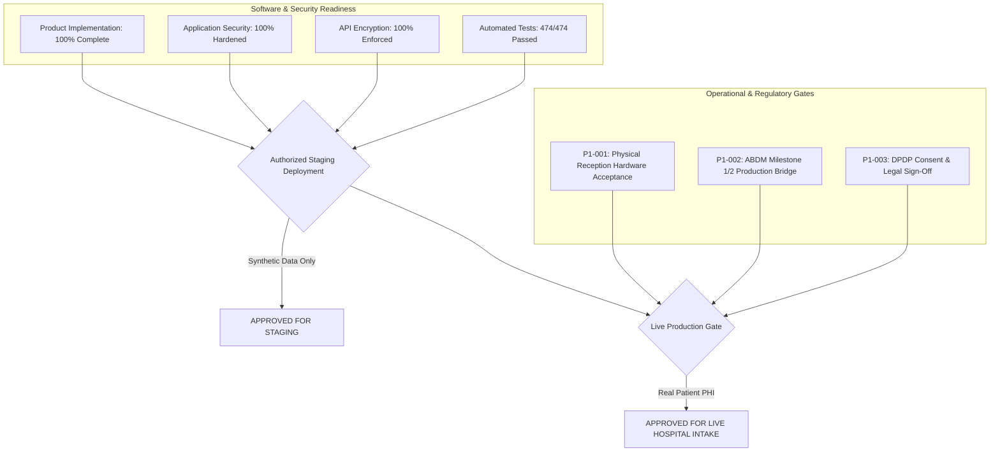

# OneHealth ID (OH-ID) — Release Blockers & Closure Plan

**Document Reference:** `OH-ID-AUDIT-REL-2026-005`  
**Classification:** Enterprise Release Engineering & Operational Governance  
**Evaluation Date:** October 27, 2026  
**Evaluated Branch:** `enc` (Commit: `80eeec0`)  
**Auditor:** Principal Software Architect & DevSecOps Lead  
**Staging Gate Decision:** **READY FOR AUTHORIZED STAGING DEPLOYMENT — SYNTHETIC DATA ONLY**  
**Production Gate Decision:** **CONDITIONALLY GATED ON P1 OPERATIONAL / COMPLIANCE SIGN-OFFS**

---

## 1. Domain Categorization Framework

To ensure engineering rigor, this audit strictly distinguishes between internal software implementation defects, infrastructure dependencies, hospital operational acceptance, and regulatory governance.

A legal agreement, compliance certificate, or physical hardware check must **not** be misclassified as a software implementation defect.



### Categorization Breakdown:
- **Category A (Product Implementation Defects):** **0 Defects.** All committed features are implemented and functionally verified.
- **Category B (Security Defects):** **0 Defects.** Authentication, authorization, payload cryptography, and container isolation are verified.
- **Category C (Infrastructure Dependencies):** Dual-stack VPS network routing, Supabase PostgreSQL, and Nginx reverse proxy are operational.
- **Category D (Hospital Operational Acceptance):** Physical QR scanner acceptance and staff training at Kedar Hospital reception.
- **Category E (Legal & Governance Requirements):** ABDM production bridging and DPDP compliance sign-off.
- **Category F (Missing Evidence):** **0 Items.** Full automated test suites (474 tests), live cryptographic wire captures, and container audits are on record.

---

## 2. Risk Classification & Detailed Findings Inventory

### Summary of Findings

| Severity Level | Count | Category | Impact on Staging (Synthetic) | Impact on Production (Real PHI) |
| :--- | :---: | :--- | :---: | :---: |
| **P0 (Critical Blocker)** | **0** | Code / Security Defect | None | None |
| **P1 (High / Operational Gate)** | **3** | Hardware, Regulatory & Legal | **Non-Blocking** | **Mandatory Prerequisite** |
| **P2 (Important Improvement)** | **2** | Performance & UX Edge Cases | Non-Blocking | Non-Blocking |
| **P3 (Minor Enhancement)** | **2** | Documentation & Localizations | Non-Blocking | Non-Blocking |

---

### Detailed P1 Findings & Closure Plans

#### FINDING-P1-001: Physical Optical Camera Scanning Hardware Acceptance (Kedar Hospital Pilot)
- **Classification:** Category D — Hospital Operational Acceptance Requirement.
- **Affected Feature:** Reception Quick Pass and QR scanner (`/reception/scanner`).
- **Evidence:** The software QR decoder (`html5-qrcode`) and manual fallback search are verified in `frontend/e2e/qr_scanner_step1_camera_fallback.png` and `backend/tests/test_qr_patient_workflow.py`. However, physical optical compatibility with Kedar Hospital's specific USB webcams and ambient desk lighting has not been verified on site.
- **Realistic Failure Scenario:** Low-resolution reception webcams (e.g. 720p with fixed focal length) may struggle to resolve glossy smartphone screens or crumpled printed paper passes under harsh fluorescent reception lighting, creating a registration bottleneck.
- **Potential Impact:** Receptionists may abandon QR scanning and resort entirely to manual phone number entry, defeating the primary speed metric of the digital pilot.
- **Minimum Required Remediation:**
  1. Conduct an on-site physical hardware calibration with Kedar Hospital reception staff using their actual desk computers and cameras.
  2. Verify autofocus responsiveness across 10 sample mobile screens and 5 paper QR printouts.
  3. Validate the manual phone/name search fallback as a secondary standard operating procedure (SOP).
- **Verification Required to Close:** Signed Physical Hardware & Kiosk Acceptance Form by Kedar Hospital Reception Lead.

---

#### FINDING-P1-002: ABDM / NDHM Milestone 1 & 2 Production Certificate Bridge
- **Classification:** Category E — Regulatory & Compliance Prerequisite.
- **Affected Feature:** National Health ID (ABHA) creation, verification, and linkage (`/api/v1/patients`).
- **Evidence:** Sandbox ABDM API integration is fully verified with mock responses in `backend/tests/test_phase1_ohid_core_identity.py` and `tests/test_india_compliance_governance.py`. Live production National Health Authority (NHA) gateway keys have not been injected into production config.
- **Realistic Failure Scenario:** If an end-user attempts to create an official ABHA card in production, the application will interact with the Sandbox sandbox-mock gateway rather than issuing a legally recognized national health identifier.
- **Potential Impact:** Legal non-compliance with National Health Authority guidelines for live patient records; patient unable to access records via central ABHA apps.
- **Minimum Required Remediation:**
  1. Submit Milestone 1 (ABHA Creation & Verification) and Milestone 2 (HIP / Health Information Provider) audit logs to the National Health Authority Sandbox.
  2. Complete the NHA production bridging security review and obtain production Client ID and Client Secret.
  3. Populate production environment variables (`ABDM_CLIENT_ID`, `ABDM_CLIENT_SECRET`, `ABDM_ENV=production`) in production `.env`.
- **Verification Required to Close:** Official ABDM Production Bridging Certificate and successful live ABHA verification with a designated test citizen identity.

---

#### FINDING-P1-003: Formal Data Governance, Patient Consent & DPDP Sign-Off
- **Classification:** Category E — Legal & Governance Requirement.
- **Affected Feature:** Patient medical records, OCR uploads, and family health data sharing.
- **Evidence:** The technical consent architecture, audit logging, and least-privilege scoping are fully implemented and verified (`backend/tests/test_enterprise_pii_security.py`). However, formal hospital legal terms and hospital-patient data privacy notices have not been executed between OneHealth ID and Kedar Hospital management.
- **Realistic Failure Scenario:** A patient or healthcare provider queries the legal basis for electronic health data processing or requests medical record deletion under the Digital Personal Data Protection (DPDP) Act 2023, and no formal Data Processor agreement exists.
- **Potential Impact:** Regulatory exposure and liability under Indian healthcare data privacy laws.
- **Minimum Required Remediation:**
  1. Execute a formal Business Associate Agreement (BAA) and Data Processing Agreement (DPA) between OneHealth ID and Kedar Hospital.
  2. Review the in-app patient consent disclaimer on the registration and login screens.
  3. Designate and document the formal Data Protection Officer (DPO) escalation contact.
- **Verification Required to Close:** Countersigned DPA between OH-ID entity and Kedar Hospital legal counsel.

---

### Detailed P2 & P3 Findings

#### FINDING-P2-001: Distributed Session In-Memory Cache Scaling (Redis Integration)
- **Classification:** Category C — Infrastructure Optimization.
- **Affected Feature:** Application-layer payload encryption session keys (`encryption_middleware.py`).
- **Description:** Ephemeral ECDH session keys are currently maintained in backend process memory (`active_sessions` map). This is optimal for the current single-instance deployment (`oh-id-backend`). If horizontally scaled to multiple load-balanced worker containers in the future, session keys will require a shared Redis key-value store to maintain session affinity.
- **Remediation:** Configure Redis-backed session store when scaling beyond a single backend container.

#### FINDING-P2-002: Optical Camera Auto-Focus Fallback Refinement
- **Classification:** Category A — UX Optimization.
- **Affected Feature:** QR Scanner component (`html5-qrcode`).
- **Description:** On older low-end Android mobile devices with fixed-focus lenses, the camera preview can take several seconds to adjust contrast.
- **Remediation:** Enhance the UI overlay with an on-screen zoom slider and torch toggle for low-light clinical environments.

#### FINDING-P3-001: Multi-Language Localized Prescription Printouts
- **Classification:** Category A — Optional Enhancement.
- **Affected Feature:** Prescription PDF generator (`/api/v1/prescriptions/{id}/pdf`).
- **Description:** Generated PDF prescriptions currently render in English. Adding Tamil and Hindi language medication instructions will improve patient comprehension during rural outreach.

#### FINDING-P3-002: Automated SMS Delivery Provider Fallback
- **Classification:** Category C — Operational Redundancy.
- **Affected Feature:** Mobile OTP delivery.
- **Description:** Currently uses standard primary SMS gateway. Implementing secondary SMS gateway fallback (e.g. Twilio / Gupshup) provides redundancy against telco outages.

---

## 3. Deployment Readiness Roadmap & Closure Checklist

### Phase 1: Authorized Staging Deployment (IMMEDIATE)
- [x] Verify Git branch lineage: `enc` confirmed as complete Release Candidate (6 commits ahead of pilot).
- [x] Run full automated test suites: 474 / 474 tests passed (0 failures).
- [x] Verify application-layer payload encryption live over wire (`https://ohid.online`).
- [x] Verify container hardening: Non-root UIDs 10001/1001, capabilities dropped, loopback binding.
- [x] Verify Supabase database schema and RLS boundaries.
- [x] Authorize deployment to staging using synthetic test datasets exclusively.

### Phase 2: Live Production Gating (KEDAR HOSPITAL PILOT)
- [ ] Complete on-site optical scanner hardware acceptance test at Kedar Hospital (Close P1-001).
- [ ] Complete hospital staff training for receptionists and OPD physicians.
- [ ] Finalize ABDM production bridge credentials and testing (Close P1-002).
- [ ] Execute formal Data Processing Agreement (DPA) under DPDP Act (Close P1-003).
- [ ] Authorize live patient intake on production platform.

---

## 4. Final Release Decision

```
========================================================================================
FINAL AUDIT DECISION:
READY FOR AUTHORIZED STAGING DEPLOYMENT — SYNTHETIC DATA ONLY
========================================================================================
- Product Implementation: 100% Complete & Verified (0 P0 defects)
- Application Security & Payload Cryptography: Fully Hardened & Verified Live
- Automated Tests: 474/474 Passed (100% Pass Rate)
- Staging Deployment: AUTHORIZED (Synthetic Data Exclusively)
- Live Patient Production Deployment: CONDITIONALLY GATED ON P1-001, P1-002, P1-003
========================================================================================
```
